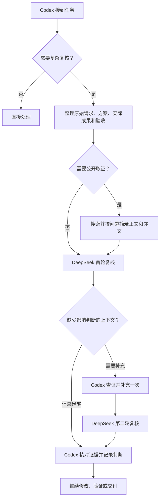

# Model IDE · Decision Review

一次核对 Codex 的 Stop 续跑行为时，搜索找到了官方文档，但旧版只取网页前 12 KB，漏掉了真正的 Stop 条款。改按问题选择正文、标题和邻文后，同一份原文里的 `stop_hook_active`、续跑含义和 `continue: false` 优先规则都进入了送审资料。

| 往返 | 原文节选 |
| --- | --- |
| Codex 提问 | 你看看这个结果是否能满足我最开始的请求意图 […] 如果这里有缺任何上下文信息请询问我。 |
| DeepSeek 首轮 | 通信提示词只看到“已清理固定模板”的说明，未看到实际提示词文本 |
| Codex 补充 | 得到的sources与Search选段回执逐字段、逐字一致，没有再裁剪 |
| DeepSeek 第二轮 | 这足以支持“头部漏条款已修复，Stop 关键证据在选段中保住”。 |

Codex 同时补上了提示词原文，最后用实际送审内容验收，也纠正了 DeepSeek 给出的错误日期。完整记录保留了顾问的追问和主助手的判断依据。[真实往返与判断](docs/recent-roundtrip.md)

## 一次复核怎么走



问句沿用用户的表达。背景能用几句话讲清就压缩，成果原文和关键验收保留。顾问回文返回当前任务，由 Codex 决定下一步。[技能说明](skills/decision-review/SKILL.md)

## 快速开始

### 1. 本地验证

准备 Git 和 Python 3.9+，在 macOS 或 Linux 终端运行。已有本地副本时，直接在仓库根目录执行最后一行。

```sh
git clone https://github.com/Johnulinkng/model-ideFORa2a_context-strategyDiscuss-.git
cd model-ideFORa2a_context-strategyDiscuss-
PYTHONDONTWRITEBYTECODE=1 python3 -m unittest discover -s skills/decision-review/scripts -p 'test_*.py' -q
```

当前版本的预期结果是 `Ran 93 tests` 和 `OK`。测试用模拟顾问回文检查项目范围、两轮上限、缓存和中断，可以在配置模型网关前运行。

### 2. 真实复核

准备 Python 3.9+、兼容的 `review-plan` 命令和能访问 DeepSeek 的本机网关配置。需要公开取证时，再准备支持 `query-paragraph-v1` 的 `review-search`。工具和网关配置由本机提供。[工具适配协议](skills/decision-review/references/adapter-contract.md)

在 Codex 里发出安装请求。

> `$skill-installer` 从 `Johnulinkng/model-ideFORa2a_context-strategyDiscuss-` 安装 `skills/decision-review`。

在**要复核的项目根目录**打开终端。如果已有兼容的 `runtime.json`，运行以下命令，按提示输入实际路径。

```sh
printf 'decision-review 安装目录的绝对路径：'
IFS= read -r REVIEW_SKILL_DIR
printf '已有 runtime.json 的绝对路径：'
IFS= read -r REVIEW_PROFILE
python3 "$REVIEW_SKILL_DIR/scripts/configure.py" \
  --profile-file "$REVIEW_PROFILE" \
  --project "$PWD"
```

看到 `"status": "configured"` 表示工具路径和当前项目范围已登记。手上有工具和网关配置时，也可以直接绑定它们。[首次配置命令](skills/decision-review/references/runtime.md)

在 Codex 打开同一个项目，把这句话和你的具体任务一起发出。

> `$decision-review` 帮我推进这项任务。在关键决策和交付前，把原始需求、方案和验收交给 DeepSeek 复核。缺信息时你查证后补一轮，最后说明采纳了哪些意见。

顾问回文返回时，复核结果为 `reviewed`，`advisors[0].content` 保存 DeepSeek 原文，`consultation.round` 显示当前轮次。Codex 写入自己的判断后，检查点成为 `decided`。[终端调用与状态说明](skills/decision-review/references/checkpoints.md)

## 项目文档

- [真实 Stop 案例与结构化摘录](docs/recent-roundtrip.md)
- [本机配置与可选 Stop 兜底](skills/decision-review/references/runtime.md)
- [运行时配置示例](skills/decision-review/runtime.example.json)
- [复核与搜索工具协议](skills/decision-review/references/adapter-contract.md)
